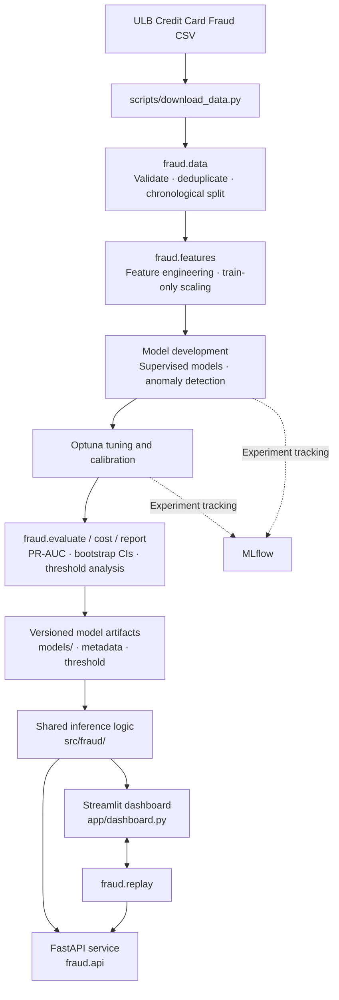

# FraudLens

**An end-to-end credit card fraud detection system built around temporal validation, explainable predictions, and cost-aware review decisions.**

FraudLens takes an imbalanced transaction dataset from raw data through model development and evaluation to a served inference API and analyst dashboard. It is designed to make the evaluation process as important as the model itself: data is split chronologically, preprocessing is fitted on training data only, PR-AUC is the primary metric, and the decision threshold is selected using an explicit review-cost assumption.

[](https://www.python.org/)
[](https://fastapi.tiangolo.com/)
[](https://streamlit.io/)
[](https://xgboost.readthedocs.io/)
[](https://www.docker.com/)
[](https://github.com/Git-Kapish/FraudLens/actions/workflows/ci.yml)
[](LICENSE)

## Overview

Credit card fraud is extremely rare in the dataset: approximately **0.17% of transactions** are fraudulent. A model that classifies every transaction as legitimate can therefore achieve approximately 99.8% accuracy while detecting no fraud at all. FraudLens avoids accuracy as its headline metric and focuses on precision-recall performance and the operational trade-off between missed fraud and manual review.

The project uses the [ULB Credit Card Fraud Detection dataset](https://www.kaggle.com/datasets/mlg-ulb/creditcardfraud), containing 284,807 transactions over two days, including 492 fraud cases. Features `V1` through `V28` are anonymised PCA components; the project reports them as such and does not assign them unsupported business meaning.

### Key capabilities

- **Temporal data preparation:** duplicate removal, schema validation, and chronological train/validation/test splitting.
- **Leakage-aware model development:** feature transformations and resampling are fitted within training workflows; validation and test data are kept out of model fitting.
- **Model comparison:** supervised classifiers and anomaly-detection approaches, with Optuna tuning and MLflow experiment tracking.
- **Imbalanced classification evaluation:** PR-AUC as the primary metric, recall at a precision constraint, and bootstrap confidence intervals.
- **Cost-aware decision threshold:** threshold selection on validation data using a configurable review-cost assumption.
- **Explainability:** SHAP contributions for individual predictions.
- **Inference interfaces:** FastAPI endpoints and a Streamlit analyst dashboard backed by shared project logic.
- **Operational tooling:** automated tests, linting, pinned dependencies, Docker Compose, and request metrics.

## Results

The reported test metrics are calculated on the **last 15% of transactions in chronological order**, containing 52 fraud cases. Results below are from `reports/results.md` generated by `make evaluate`.

### Model comparison

| Model | Test PR-AUC | Recall at 90% precision |
|---|---:|---:|
| Random Forest | **0.778** | **0.750** |
| XGBoost + SMOTE | 0.769 | 0.731 |
| XGBoost, tuned with Optuna | 0.766 | 0.750 |
| XGBoost (`scale_pos_weight`) | 0.765 | 0.750 |
| **Deployed: calibrated XGBoost** | **0.749** | **0.712** |
| Logistic Regression | 0.699 | 0.673 |
| Rank-average (tuned XGBoost + autoencoder) | 0.594 | 0.000 |
| Autoencoder (legitimate-only) | 0.132 | 0.000 |
| Isolation Forest | 0.048 | 0.000 |
| Dummy prior baseline | 0.001 | 0.000 |

### Confidence intervals

The following are 95% bootstrap confidence intervals based on 500 resamples.

| Model | Test PR-AUC | Recall at 90% precision |
|---|---:|---:|
| Random Forest | 0.778 [0.665, 0.872] | 0.750 [0.616, 0.855] |
| XGBoost | 0.765 [0.645, 0.872] | 0.750 [0.600, 0.854] |
| Deployed calibrated XGBoost | 0.749 [0.626, 0.858] | 0.712 [0.559, 0.852] |

**Interpretation matters:** the intervals overlap substantially. With only 52 fraud cases in the test set, the results do not establish that the top supervised models are meaningfully different. The deployed model was selected using validation data before the test set was evaluated; it was not replaced after seeing the test results. Its PR-AUC of 0.749 narrowly misses the project target of 0.75.

### Cost analysis

The cost model assumes that a missed fraud costs the transaction's `Amount`, a flagged transaction incurs a manual review cost (`review_cost`, default 5.0), and a true negative has no cost. The review cost is a configurable assumption, not a measured operational value.

The validation-selected threshold of **0.2812** was applied to the test set:

| Strategy | Test cost | Saving versus flagging nothing |
|---|---:|---:|
| Flag nothing | 6,169 | — |
| Deployed model, validation-selected threshold | 2,632 | 3,536 (57.3%) |
| Fixed threshold of 0.5 | 2,592 | 3,576 (58.0%) |

At the deployed threshold, precision and recall were both 0.750: 39 frauds were caught, 13 legitimate transactions were flagged, and 13 frauds were missed. The validation-selected cost threshold did **not** outperform 0.5 on the test set. The cost simulation therefore does not demonstrate a reliable advantage over the default threshold for this calibrated model.

All financial results depend on the assumed review cost. The dataset does not specify the currency for transaction amounts.

### API latency

A local benchmark of 500 sequential `POST /predict` requests, using one worker, recorded **36 ms p95 round-trip latency** (27 ms server-side). This was below the project's 50 ms target in the measured runs. It is a single-machine, sequential benchmark and should not be interpreted as a throughput or concurrent-load result.

## Architecture

The pipeline separates data preparation, model development, evaluation, and serving. The FastAPI service and Streamlit dashboard use the shared implementation in `src/fraud/`.




## Getting started

### Prerequisites

- Python 3.11
- GNU Make (on Windows, `mingw32-make` can be used)
- Docker and Docker Compose (optional, for containerized use)
- Kaggle API credentials for automated dataset download

### 1. Clone the repository

```bash
git clone https://github.com/Git-Kapish/FraudLens.git
cd FraudLens
```

### 2. Install dependencies and prepare the data

```bash
make setup
make data
```

The dataset download requires Kaggle credentials at `~/.kaggle/kaggle.json`. If the download fails, the command prints manual instructions. FraudLens does not generate synthetic replacement data.

### 3. Train and evaluate

```bash
make train
make evaluate
```

Training runs the model workflows, tuning, and calibration, then saves artifacts under `models/`. Evaluation scores the held-out test set, calculates confidence intervals and cost analysis, generates SHAP outputs, and writes `reports/results.md`.

**The test set is intended for final evaluation, not model selection.** The project records the results after model and threshold choices have been made.

### 4. Run tests and lint checks

```bash
make test
make lint
```

### 5. Start the API and dashboard

Run the API:

```bash
make serve
```

Run the dashboard in a separate terminal:

```bash
make dashboard
```

| Service | Local URL |
|---|---|
| FastAPI | http://localhost:8000 |
| Interactive API documentation | http://localhost:8000/docs |
| Streamlit dashboard | http://localhost:8501 |

The repository includes trained model artifacts, so serving does not require retraining. The dashboard also requires the source dataset, which is prepared by `make data`.

## Run with Docker

Prepare the dataset first because the dashboard reads it from a mounted directory:

```bash
make data
docker compose up --build
```

The API is exposed on port `8000` and the dashboard on port `8501`. The runtime image uses `requirements-serve.txt`, which excludes training and notebook dependencies such as PyTorch, MLflow, and Jupyter.

## API reference

FraudLens exposes the following FastAPI endpoints:

| Endpoint | Method | Purpose |
|---|---|---|
| `/health` | GET | Liveness, model version, and decision threshold |
| `/predict` | POST | Score a single transaction |
| `/predict/batch` | POST | Score up to 1,000 transactions |
| `/explain` | POST | Return a prediction with the top five signed SHAP contributions |
| `/metrics` | GET | Request counts, flag rate, and p50/p95 latency |

### Example request

```bash
curl -X POST "http://localhost:8000/predict" \
  -H "Content-Type: application/json" \
  -d '{"Time": 0, "V1": 0, "...": "...", "V28": 0, "Amount": 25.0}'
```

The actual request must include all 30 model input features: `Time`, `V1` through `V28`, and `Amount`. `Amount` must be non-negative. Invalid input is rejected with HTTP 422.

Prediction responses include `fraud_probability`, `is_fraud`, `threshold`, `model_version`, and `latency_ms`. Request logs record the request identifier, score, and latency; raw feature values are not logged.

## Analyst dashboard

The Streamlit dashboard supports an end-to-end review workflow:

1. **Overview:** transaction volume, fraud counts, fraud rate over time, and chronological split boundaries.
2. **Model comparison:** test metrics, precision-recall and ROC curves, and bootstrap confidence intervals.
3. **Threshold and cost analysis:** adjust the review-cost assumption and inspect how the validation-selected threshold affects precision, recall, and total cost.
4. **Transaction explorer:** inspect high-scoring transactions and their SHAP contributions.
5. **Live replay:** stream selected transactions through the API and observe the running cost comparison.

## Design decisions

The full rationale is documented in [`reports/decisions.md`](reports/decisions.md). Core decisions include:

- **Chronological splitting:** remove 1,081 exact duplicates before splitting 70/15/15 by `Time`; the resulting partitions contain 366, 55, and 52 fraud cases.
- **Training-only fitting:** fit the scaler on training data; keep SMOTE inside the training pipeline; fit calibration using out-of-fold training predictions.
- **One final test evaluation:** freeze model and threshold choices before scoring the test partition.
- **Evidence-led model selection:** the tuned XGBoost model did not outperform the untuned candidate on validation, so the untuned XGBoost was deployed.
- **Explainability scope:** SHAP explains the raw XGBoost score in log-odds before isotonic calibration. It explains ranking contributions, not calibrated probabilities.
- **Input-error handling:** a custom FastAPI validation handler avoids echoing raw invalid feature values in error responses.

## Limitations

FraudLens is an applied ML project and is not a production-ready fraud prevention service. Its results should be interpreted with the following constraints:

- **Small evaluation sample:** only 52 fraud cases are present in the test partition; model comparisons have substantial uncertainty.
- **Anonymised predictors:** `V1`-`V28` are PCA components and cannot be given direct business interpretations from this dataset.
- **Limited time coverage:** the dataset spans two days and represents European cardholders from 2013. It does not establish performance across other time periods, regions, or fraud patterns.
- **Assumption-driven cost model:** review cost is configurable rather than measured. Treating transaction amount as the cost of a missed fraud omits chargeback fees, customer friction, and repeated fraud.
- **Validation reuse:** validation data is used for model choice, calibration comparison, and threshold selection. Validation metrics may therefore be optimistic; the chronological test evaluation is the more useful estimate.
- **Calibration uncertainty:** at this low fraud prevalence, reliability-curve bins contain few fraud cases. Isotonic calibration creates tied scores and slightly reduces PR-AUC in the reported results.
- **Threshold sensitivity:** the validation cost curve is nearly flat near its minimum, and small platform-level numerical differences can change the chosen threshold and flagged transactions.
- **Limited latency evidence:** latency was measured on one laptop with sequential requests, not under concurrent production load.
- **Missing production controls:** authentication, rate limiting, continuous drift monitoring, and automated retraining are not implemented. In-memory metrics reset when the service restarts.

## Reproducibility

Dependencies are pinned and random seed 42 is configured for NumPy, scikit-learn, XGBoost, PyTorch, and Optuna. Serialized models should be loaded with the pinned scikit-learn and XGBoost versions used during training.

A fresh Windows checkout reproduced the committed results and files exactly. Windows and Linux runs were close but not bit-for-bit identical: floating-point differences in XGBoost and PyTorch affected some scores, Optuna selections, ensemble results, and the selected cost threshold. The same deployed model family was selected.

See [`reports/decisions.md`](reports/decisions.md) for the reproducibility notes and implementation rationale.

## Repository structure

```text
FraudLens/
├── src/fraud/       # Data, features, models, evaluation, cost, explainability, API
├── app/             # Streamlit analyst dashboard
├── scripts/         # Dataset download and replay utilities
├── notebooks/       # Exploratory data analysis
├── tests/           # Automated test suite
├── models/          # Trained artifacts and model metadata
├── reports/         # Results, decisions, SHAP examples, and figures
├── config.yaml      # Training, split, cost, and API configuration
├── Dockerfile
├── docker-compose.yml
├── Makefile
└── requirements-serve.txt
```

## License

This project is licensed under the [MIT License](LICENSE).
