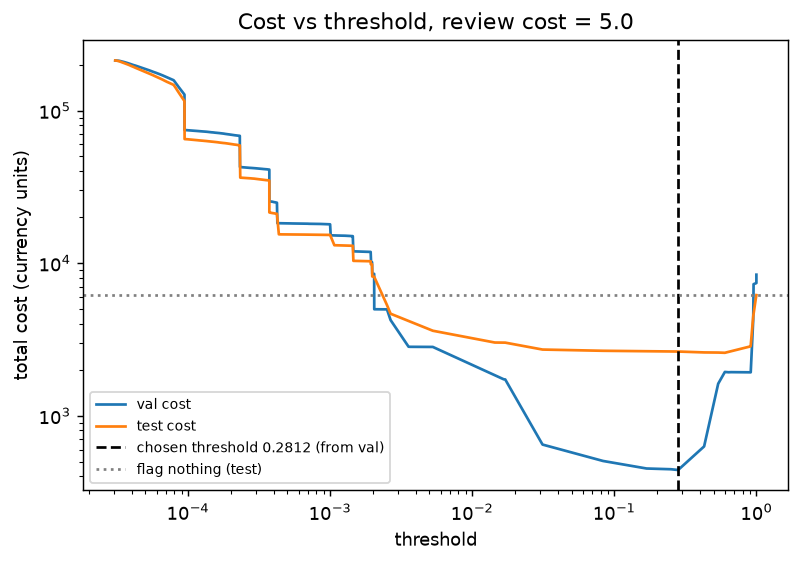
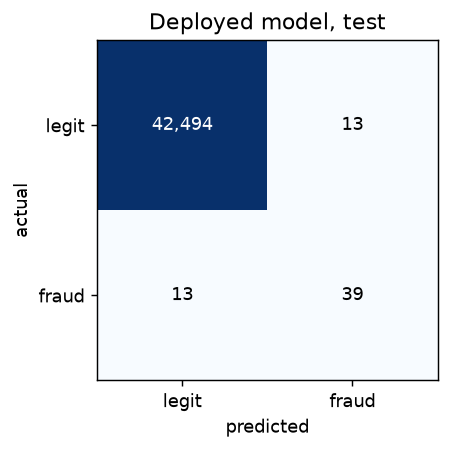
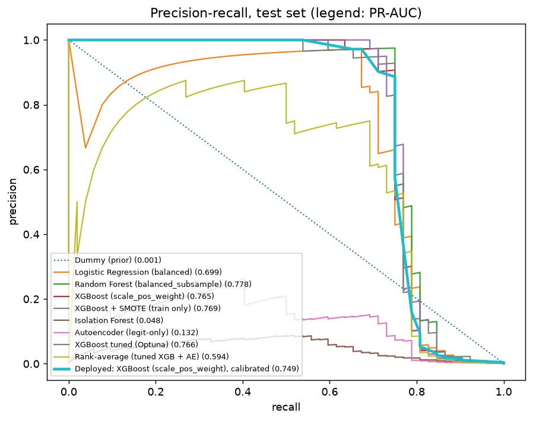
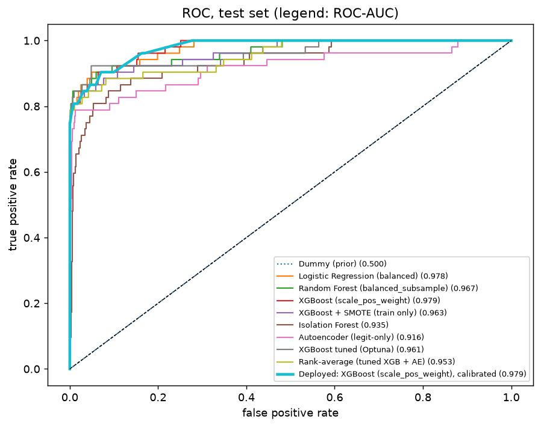
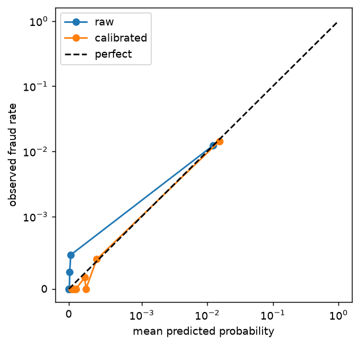

# Results

Generated by `make evaluate` (`src/fraud/evaluate.py`). Model version `M3_xgb-20261030`, seed 42.
The test set was scored only after training, tuning, calibration and threshold choice were frozen on train/validation.
Headline metric is **PR-AUC (average precision)**. Accuracy is not reported: with 0.17% fraud it carries no information.
Amounts are in the dataset's currency units (the dataset does not state the currency).

## Data
Exact duplicates removed before splitting: **1,081**. Chronological split by `Time` (70/15/15):

| Split | Rows | Frauds |
|---|---|---|
| train | 198,608 | 366 |
| val | 42,559 | 55 |
| test | 42,559 | 52 |

## Model comparison (test set)
Sorted by test PR-AUC. ROC-AUC is secondary and optimistic here: with so few frauds the huge legit class keeps the false positive rate tiny, so ROC-AUC looks high even for a poor ranker.

| Model | Val PR-AUC | Test PR-AUC | Test ROC-AUC | Recall @ 90% precision | Precision @ 80% recall |
|---|---|---|---|---|---|
| Random Forest (balanced_subsample) | 0.863 | 0.778 | 0.967 | 0.750 | 0.282 |
| XGBoost + SMOTE (train only) | 0.818 | 0.769 | 0.963 | 0.731 | 0.194 |
| XGBoost tuned (Optuna) | 0.837 | 0.766 | 0.961 | 0.750 | 0.140 |
| XGBoost (scale_pos_weight) | 0.858 | 0.765 | 0.979 | 0.750 | 0.104 |
| Deployed: XGBoost (scale_pos_weight), calibrated | 0.847 | 0.749 | 0.979 | 0.712 | 0.094 |
| Logistic Regression (balanced) | 0.827 | 0.699 | 0.978 | 0.673 | 0.237 |
| Rank-average (tuned XGB + AE) | 0.751 | 0.594 | 0.953 | 0.000 | 0.086 |
| Autoencoder (legit-only) | 0.060 | 0.132 | 0.916 | 0.000 | 0.011 |
| Isolation Forest | 0.040 | 0.048 | 0.935 | 0.000 | 0.018 |
| Dummy (prior) | 0.001 | 0.001 | 0.500 | 0.000 | 0.001 |

## Bootstrap 95% confidence intervals
500 bootstrap resamples of the test set. Models shown: the top 2 by *validation* PR-AUC (chosen before looking at test) plus the deployed model. With only 52 test frauds the intervals are wide; differences between close models are not meaningful.

| Model | Test PR-AUC [95% CI] | Recall @ 90% precision [95% CI] |
|---|---|---|
| Random Forest (balanced_subsample) | 0.778 [0.665, 0.872] | 0.750 [0.616, 0.855] |
| XGBoost (scale_pos_weight) | 0.765 [0.645, 0.872] | 0.750 [0.600, 0.854] |
| Deployed: XGBoost (scale_pos_weight), calibrated | 0.749 [0.626, 0.858] | 0.712 [0.559, 0.852] |

## Operating point at the cost-optimal threshold
Each model's threshold is chosen on **validation** by minimising total cost (review cost = 5.0), then applied unchanged to test.

| Model | Threshold (val) | Precision | Recall | F1 | F2 | Flagged | Test cost | Saving vs flag-nothing |
|---|---|---|---|---|---|---|---|---|
| Random Forest (balanced_subsample) | 0.3335 | 0.812 | 0.750 | 0.780 | 0.762 | 48 | 2,612 | 57.7% |
| XGBoost + SMOTE (train only) | 0.8032 | 0.826 | 0.731 | 0.776 | 0.748 | 46 | 2,642 | 57.2% |
| XGBoost tuned (Optuna) | 0.3565 | 0.696 | 0.750 | 0.722 | 0.739 | 56 | 2,652 | 57.0% |
| XGBoost (scale_pos_weight) | 0.3326 | 0.830 | 0.750 | 0.788 | 0.765 | 47 | 2,607 | 57.7% |
| Deployed: XGBoost (scale_pos_weight), calibrated | 0.2812 | 0.750 | 0.750 | 0.750 | 0.750 | 52 | 2,632 | 57.3% |
| Logistic Regression (balanced) | 0.9997 | 0.650 | 0.750 | 0.696 | 0.728 | 60 | 2,672 | 56.7% |
| Rank-average (tuned XGB + AE) | 0.9936 | 0.679 | 0.692 | 0.686 | 0.690 | 53 | 2,724 | 55.8% |
| Autoencoder (legit-only) | 3.794 | 0.145 | 0.635 | 0.237 | 0.379 | 227 | 3,724 | 39.6% |
| Isolation Forest | 0.07006 | 0.075 | 0.558 | 0.132 | 0.243 | 388 | 5,666 | 8.1% |
| Dummy (prior) | 0.001843 | 0.000 | 0.000 | 0.000 | 0.000 | 0 | 6,169 | 0.0% |

## Cost analysis (deployed model)
**`review_cost = 5.0` is an assumption, not a measured value.** Cost model: a missed fraud costs its `Amount`; every flagged transaction (true or false positive) costs `review_cost`; a true negative costs 0.

| Strategy | Test cost | Saving vs flag-nothing |
|---|---|---|
| Flag nothing | 6,169 | - |
| Deployed model at val-chosen threshold 0.2812 | 2,632 | 3,536 (57.3%) |
| Threshold 0.5 | 2,592 | 3,576 (58.0%) |

Confusion matrix on test at the chosen threshold: TP 39, FP 13, FN 13, TN 42,494.

### Sensitivity to review cost
The threshold is re-chosen on validation for each review cost, then applied to test.

| Review cost | Threshold (val) | Flagged | Precision | Recall | Test cost | Flag-nothing cost | Saving | Saving % |
|---|---|---|---|---|---|---|---|---|
| 1 | 0.2812 | 52 | 0.750 | 0.750 | 2,424 | 6,169 | 3,744 | 60.7% |
| 5 | 0.2812 | 52 | 0.750 | 0.750 | 2,632 | 6,169 | 3,536 | 57.3% |
| 10 | 0.2812 | 52 | 0.750 | 0.750 | 2,892 | 6,169 | 3,276 | 53.1% |
| 25 | 0.4286 | 45 | 0.867 | 0.750 | 3,497 | 6,169 | 2,671 | 43.3% |

## Curves

## API latency
<!-- latency:start -->
`POST /predict`, 500 sequential calls on localhost, one worker, after a warm-up. Target: p95 < 50 ms (met).

| | p50 (ms) | p95 (ms) |
|---|---|---|
| Server-side `latency_ms` | 16.27 | 20.74 |
| Client round trip | 23.53 | 28.76 |
<!-- latency:end -->

## Caveats
- The test set has 52 frauds, so every test number is noisy. Use the intervals, not point estimates, to compare models; the top models are statistically indistinguishable.
- A chronological split is harder than the random splits behind most published numbers on this dataset, because fraud patterns drift and later rows are never seen in training. Test PR-AUC (0.749 deployed) is below validation (0.847). That drop is expected and is not hidden.
- PRD target of PR-AUC >= 0.75: the deployed model scores 0.749, the best model on test (Random Forest (balanced_subsample)) scores 0.778. Their intervals span the target. No tuning was done to hit it.
- Deployed model selection was frozen on validation (best XGBoost-family model, chosen for TreeExplainer and latency), so it was not switched after seeing test results, even though Random Forest (balanced_subsample) scores higher on test within noise.
- Isotonic calibration makes scores piecewise-constant, which creates ties. That lowers the deployed model's PR-AUC (0.749) versus its uncalibrated base (0.765), and can make nearby review costs pick the same threshold (see sensitivity table).
- The validation-chosen threshold (0.2812) costs 2,632 on test versus 2,592 at 0.5, i.e. no better than the 0.5 baseline. The difference is a few transactions; the cost model does not show a reliable advantage over 0.5 for this calibrated model.
- Isolation Forest and the autoencoder rank poorly on their own; the ensemble that includes the autoencoder is reported even though it does not beat XGBoost.
- Costs depend on the assumed review cost and on a single two-day window of data.
