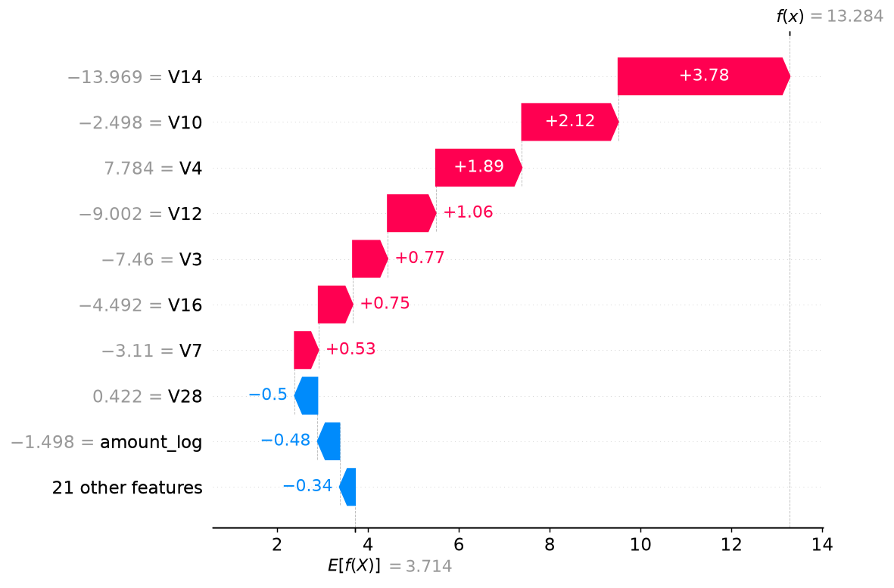
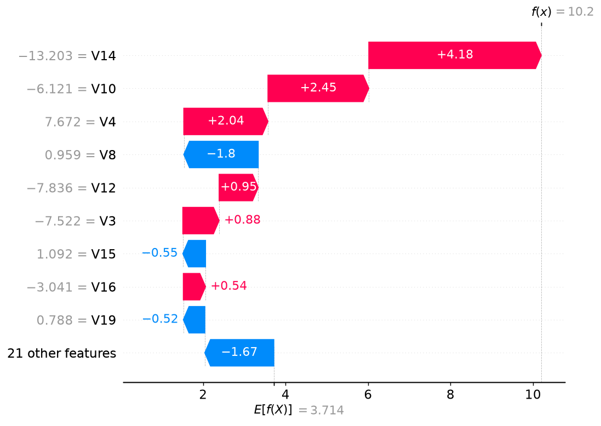
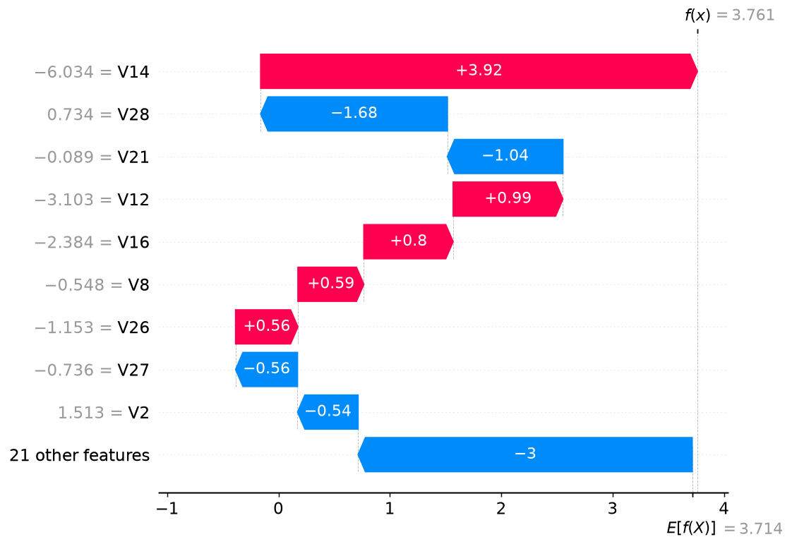

# SHAP examples (flagged true frauds on the test set)

Contributions are log-odds of the raw XGBoost score (before calibration). `V1`-`V28` are anonymised PCA components, so no business meaning is implied. `amount_log` and `hour` are standardised model-space values. Examples are picked by score only: highest, middle and lowest-scoring flagged frauds.

## Example 1: calibrated score 1.0000, Amount 1.00

| Feature | Value | Contribution |
|---|---|---|
| V14 | -13.969 | +3.778 |
| V10 | -2.498 | +2.122 |
| V4 | 7.784 | +1.893 |
| V12 | -9.002 | +1.063 |
| V3 | -7.460 | +0.767 |

## Example 2: calibrated score 0.9500, Amount 0.77

| Feature | Value | Contribution |
|---|---|---|
| V14 | -13.203 | +4.181 |
| V10 | -6.121 | +2.445 |
| V4 | 7.672 | +2.041 |
| V8 | 0.959 | -1.805 |
| V12 | -7.836 | +0.948 |

## Example 3: calibrated score 0.5385, Amount 4.90

| Feature | Value | Contribution |
|---|---|---|
| V14 | -6.034 | +3.921 |
| V28 | 0.734 | -1.676 |
| V21 | -0.089 | -1.038 |
| V12 | -3.103 | +0.986 |
| V16 | -2.384 | +0.802 |

